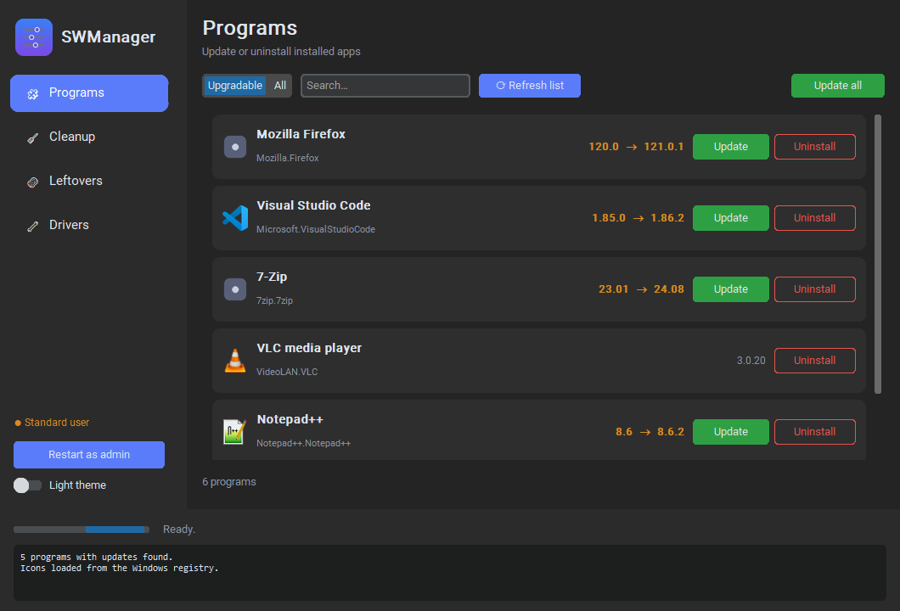

# SWManager

A software manager for Windows, written in Python with a **modern UI
(CustomTkinter)**: navigation sidebar, dark/light mode, and a **per-program
icon** next to every entry. It lets you **update and uninstall programs**,
**clean up the PC** from temporary files, find **leftovers of uninstalled
programs**, and **check drivers** — all using the official Windows tooling.



## Features

### 🧩 Programs (via `winget`)
- **Upgradable / All** — list apps that have updates, or every installed app.
- **Update selected / Update all** — silent upgrades.
- **Uninstall** — with confirmation.
- Real-time name/Id filter, per-program icons.
- **Smart uninstall recovery**:
  - *Multiple versions installed* → offers to remove **all versions**.
  - *"Application not found"* (ghost entries still listed after the app is
    gone) → finds and removes the leftover **MSIX package** or the orphaned
    **registry entry**, so it disappears from the list.
  - **Right-click any program → “Force remove leftover entry”** to clean a
    ghost entry directly, without waiting for winget to fail.
- The list **keeps its scroll position** after an uninstall — no re-scrolling.

### 🧹 Cleanup
- **Analyze space** — recoverable size per category: user temp, Windows temp,
  Prefetch, Windows Update cache, thumbnails, Edge and Chrome caches, Recycle
  Bin.
- **Clean selected** — deletes only the checked categories, with confirmation.
  Files in use are skipped without interrupting the operation.

### 🧽 Leftovers (uninstalled programs)
Cleans up what remains after an uninstall. Three modes:
- **Shortcuts** — broken `.lnk` shortcuts (Desktop, Start Menu) that point to
  files that no longer exist. Reliable, **preselected**.
- **Empty folders** — leftover folders with no files. Safe, preselected.
- **Leftover folders** — heuristic: folders in AppData/ProgramData/Program
  Files not matched to any installed program. **Not** preselected — review
  manually (may include caches or portable apps still in use).

Use the **Select all** checkbox to toggle the whole list at once.

> All deletions go to the **Recycle Bin** (recoverable), never permanent.
> Windows system junctions (e.g. "Application Data") are excluded automatically.

### 🔧 Drivers
- **Check for updates** — uses the official *Windows Update Agent* API.
- **Problem devices** — only present devices in an error state.
- **Installed drivers** — third-party driver packages (`pnputil`).
- **Scan hardware** / **Windows Update** — trigger detection or open settings.

> On Windows, drivers install reliably only through Windows Update or vendor
> tools. SWManager **finds** updates but delegates installation to Windows
> Update — no third-party driver database.

## Requirements
- Windows 10/11
- Python 3.10+ (tested on 3.13)
- Python packages: `customtkinter`, `pillow`
- `winget` (App Installer from the Microsoft Store) for the Programs tab

## Install

```powershell
pip install -r requirements.txt
```

## Run

```powershell
python main.py
```

or double-click **`run.bat`** (launches without a console window).

### Administrator rights
Some actions (Windows temp, Prefetch, Windows Update cache, some drivers, and
removing registry ghost entries under HKLM) require elevation. The app shows
whether you are an administrator and offers a **“Restart as admin”** button
(UAC). Categories that need elevation are marked `[admin]`.

## Project layout

```
SWManager/
├─ main.py              # entry point
├─ run.bat              # quick launcher
├─ requirements.txt     # dependencies (customtkinter, pillow)
├─ assets/              # logo (PNG/ICO) + generator
└─ swmanager/
   ├─ utils.py          # command execution, privileges, formatting
   ├─ programs.py       # winget: list / update / uninstall / recovery
   ├─ cleanup.py        # temporary files and cache cleanup
   ├─ drivers.py        # driver listing and update checks
   ├─ leftovers.py      # leftovers from uninstalled programs
   ├─ icons.py          # program icon extraction from the registry
   └─ gui.py            # modern UI (CustomTkinter)
```

## Safety notes
- Every destructive action (uninstall, cleanup, leftover deletion) asks for
  confirmation.
- Cleanup empties temp folders without removing them and skips locked/in-use
  files.
- Leftover deletions go to the Recycle Bin and are recoverable.
- No data leaves the PC: the app only uses local Windows tools.

## License

Released under the [MIT License](LICENSE). Replace the copyright holder in
`LICENSE` with your own name before publishing if you wish.
